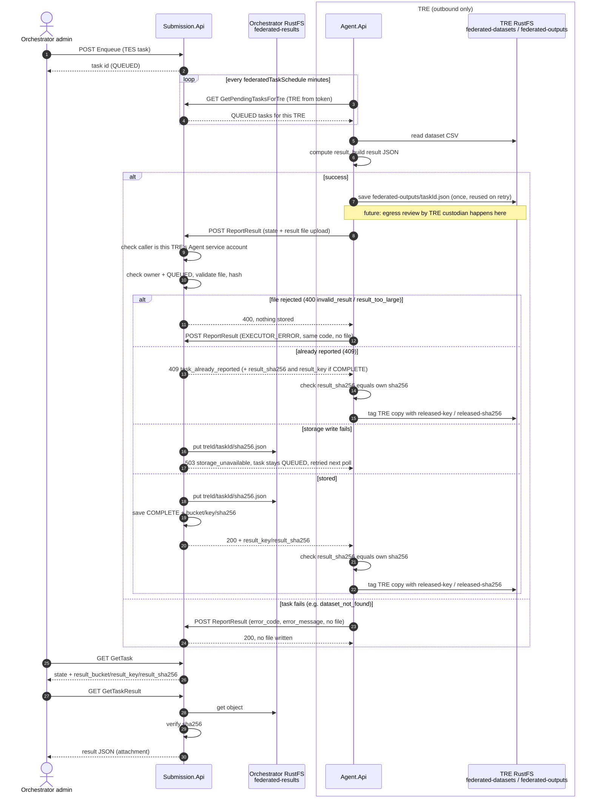

# Federated tasks

The orchestrator (Submission.Api) queues a GA4GH TES task for one TRE. The TRE Agent (Agent.Api) polls for it, reads a CSV dataset from the TRE bucket, runs `count` or `mean`, and reports the result.

There is no DAAMS signing or approval gate yet.

To try the flow locally, see [dev/federated](../dev/federated/README.md). It is a Docker Compose stack with both APIs, Keycloak, RustFS and a sample dataset.

## Flow

1. A `dare-control-admin` user calls `POST /api/FederatedTask/Enqueue` with a TES task. Submission validates it against the federated profile. The task is stored as `QUEUED`. The response holds the task id.
2. The Agent job `Run Federated Tasks` (`JobSettings:FederatedTaskJobName`) runs every `JobSettings:federatedTaskSchedule` minutes. It calls `GET /api/FederatedTask/GetPendingTasksForTre`. The TRE is taken from the token.
3. The Agent reads the one `.csv` under `dataset/<name>/` in the dataset bucket.
4. The Agent runs the operation in-process. It does not start a container. The result is a JSON file (see "Task state and result").
5. The Agent saves the file in the TRE bucket `federated-outputs` as `<taskId>.json`. If the file is already there from an earlier poll, the Agent reuses it and does not compute again.
6. The Agent releases the file: `POST /api/FederatedTask/ReportResult` with the file as an upload. Submission checks the caller and the file, and stores it in the orchestrator bucket `federated-results`.
7. The Agent compares the SHA-256 that Submission stored with the SHA-256 of its own copy. If they match, it adds the metadata `released-key` and `released-sha256` to the TRE copy.
8. A `dare-control-admin` user calls `GET /api/FederatedTask/GetTask?id=<taskId>` for the state and where the result is stored, and `GET /api/FederatedTask/GetTaskResult?id=<taskId>` for the file.

If the Agent cannot save the file, or the release fails (network error, 5xx, or a 4xx that is not listed under "Reporting a result"), the task stays `QUEUED` and the Agent tries again at the next poll. A task that fails before there is a file (for example `dataset_not_found`) is reported as an error state, with no file, and does not go through save and release.

`GetPendingTasksForTre` and `ReportResult` accept only the TRE Agent's service account (role `dare-tre-admin`). See "Reporting a result". `Enqueue`, `GetTask` and `GetTaskResult` need `dare-control-admin`.



### API errors

Every 4xx from these endpoints has the same JSON body. Its keys are the same as the error keys in a failed task's `logs[0].metadata`:

```json
{ "error_code": "invalid_task", "error_message": "TaskId must be a GUID" }
```

| Status | `error_code` | When |
|---|---|---|
| 400 | `invalid_task`, or any profile code from the table below (for example `unknown_operation`) | The request or the task is not valid. This includes a form with an unknown `State` value or a bad `ErrorCode`, and a request over the size limit of `ReportResult` (73728 bytes). |
| 400 | `invalid_result` | `ReportResult`: the result file is not valid, or does not match the task. |
| 400 | `result_too_large` | `ReportResult`: the result file is over 65536 bytes. |
| 404 | `task_not_found` | No such task. `ReportResult` also returns this for a task that belongs to another TRE. |
| 404 | `result_not_found` | `GetTaskResult`: the task is not `COMPLETE`. |
| 409 | `task_already_reported` | `ReportResult` for a task that already has a result. When the task is `COMPLETE`, the body also has `result_sha256` and `result_key`. |
| 500 | `internal_error` | `GetTaskResult`: the stored file does not match its SHA-256. The file is not returned. |
| 503 | `storage_unavailable` | The orchestrator bucket cannot be reached. For `ReportResult` the task stays `QUEUED`. |

`result_not_found` and `storage_unavailable` are returned by the API only. An Agent never reports them as a task result.

401 and 403 come from authentication and have no body. `ReportResult` and `GetPendingTasksForTre` return 403 to any caller that is not a TRE Agent service account.

A `ReportResult` with state `EXECUTOR_ERROR` or `SYSTEM_ERROR` must have an `ErrorCode`, or it gets a 400. Any code that matches `^[a-z_]{1,64}$` is accepted, not only the ones listed below. `ErrorMessage` is at most 512 characters and has no control characters.

### Reporting a result

`POST /api/FederatedTask/ReportResult` is `multipart/form-data`.

| Field | Rule |
|---|---|
| `TaskId` | The task GUID. |
| `State` | `COMPLETE`, `EXECUTOR_ERROR` or `SYSTEM_ERROR`. |
| `ErrorCode`, `ErrorMessage` | Error states only. See the limits above. |
| `DatasetSha256` | Error states only. 64 lowercase hex characters. On `COMPLETE` Submission takes it from the result file. |
| `result` (file) | Required for `COMPLETE`. Not allowed for an error state. One file only. |

Submission checks the caller first. Only the Agent service account of a TRE is accepted: the token `azp` is the TRE's Keycloak client id, and `preferred_username` is `service-account-<clientId>`, with role `dare-tre-admin`. Anyone else gets 403, whatever the request holds. The TRE comes from the token, never from the form or the file. A request over 73728 bytes is rejected by the framework with 400 `invalid_task`, before this check.

The `result` file:

- It is at most 65536 bytes, or the answer is 400 `result_too_large`.
- It is UTF-8 JSON, nested at most 16 levels, with no duplicate property names. It must match the result document and the task (`taskId`, `tre`, `studyId`, `operation`, `dataset`), or the answer is 400 `invalid_result`. The message names the field and never repeats the content.
- The file name of the upload is ignored. Submission builds the storage key itself.

A 200 response has `result`, `result_bucket`, `result_key` and `result_sha256`. The last three are only for `COMPLETE`.

If Submission cannot write the file, it answers 503 `storage_unavailable` and the task stays `QUEUED`. If the Agent gets 400 `invalid_result` or `result_too_large`, it sends a follow-up `EXECUTOR_ERROR` report with the same code. A 409 for a `COMPLETE` task carries `result_sha256` and `result_key`, because the Agent cannot call `GetTask`. The Agent compares the sha256 with its own copy and, if they are equal, tags the TRE copy with the key. The Agent only gets this 409 when two reports for the same task race. It does not ask again later.

The tag can be missing on a released file. This happens when the Agent does not get the 200 (a timeout after Submission saved the result, or an Agent restart), or when tagging fails. Submission then has the task as `COMPLETE` and never gives it to the Agent again, so nothing adds the tag later. A missing tag does not mean the file was not released. To check, compare the TRE copy's SHA-256 with `result_sha256` from `GetTask`.

TODO: re-tag released TRE copies that have no `released-key` (follow-up ticket).

## The federated TES profile

| TES field | Rule |
|---|---|
| `executors` | Exactly 1. `image` must be `5s-tes/federated-ops:1`. |
| `executors[0].command` | `[<operation>, ...args]`. The operation is `count` or `mean`. |
| command args | `--column <name>`: at most once. Required for `mean`, optional for `count`. `--filter <column>:<op>:<value>`: repeatable. |
| filter `<op>` | `eq`, `gt`, `lt`, `gte` or `lte`. Split on the first two `:` only, so a value may contain `:`. |
| `inputs` | Exactly 1. `url` is `dataset://<name>`. |
| `outputs` | Must be null or empty. The result is returned in the task log. |
| `tags` | `tres` names exactly one existing TRE. It is trimmed and lowercased, and must not contain `\|`. `study_id` must not be empty. Both are at most 1024 characters, the limit for strings in the result document. |
| `resources`, `volumes`, `name`, `description` | Accepted and ignored. |

The dataset name must match `^[a-z0-9][a-z0-9_-]{0,62}$`.

Example: the mean of `age` on dataset `cohort_2024`, for rows where `sex` is `F`.

```json
{
  "executors": [
    {
      "image": "5s-tes/federated-ops:1",
      "command": ["mean", "--column", "age", "--filter", "sex:eq:F"]
    }
  ],
  "inputs": [
    {
      "url": "dataset://cohort_2024",
      "path": "/data/cohort_2024",
      "type": "DIRECTORY"
    }
  ],
  "outputs": [],
  "tags": {
    "tres": "my-tre",
    "study_id": "study-001"
  }
}
```

### Task state and result

| State | When |
|---|---|
| `QUEUED` | The task is enqueued. |
| `COMPLETE` | The task succeeded. |
| `EXECUTOR_ERROR` | The task could not run against the data. All error codes except `internal_error` and `tre_renamed`. |
| `SYSTEM_ERROR` | `internal_error` or `tre_renamed`. |

The result is in `logs[0].metadata`.

- On success: `result_bucket`, `result_key` and `result_sha256`. They say where the result file is stored in the orchestrator, and its SHA-256. The values are in the file, not in the metadata.
- On error: `error_code` and `error_message`.
- `dataset_sha256` is added whenever the Agent read the dataset file, on success and on errors raised after the read (including `invalid_dataset`). It is the lowercase hex SHA-256 of the exact bytes of the CSV. It is absent when the file was not read (`invalid_task`, `dataset_not_found`, `ambiguous_dataset`, `invalid_dataset_name`, `tre_renamed`, and `internal_error` before the read). An empty file gives `invalid_dataset` with the hash.

### Result document

The result file is one JSON document. The property names are camelCase. `schemaVersion` is `1`. `tre` is the TRE name in lowercase.

```json
{
  "schemaVersion": 1,
  "taskId": "0b9a3c4e-6f1d-4c1e-9a52-3d7b8e2f1a10",
  "tre": "my-tre",
  "studyId": "study-001",
  "operation": "mean",
  "dataset": "cohort_2024",
  "datasetSha256": "9f86d081884c7d659a2feaa0c55ad015a3bf4f1b2b0b822cd15d6c15b0f00a08",
  "completedAt": "2026-11-05T09:30:00+00:00",
  "result": {
    "kind": "scalar",
    "value": 41.5,
    "rowCount": 120
  }
}
```

`result.value` is a decimal. It is `null` when there are no rows. `result.kind` is always `scalar` for now.

The file is stored under the key `<treId>/<taskId>/<sha256>.json` in the orchestrator bucket `federated-results`. `treId` is the TRE id in Submission and `sha256` is the SHA-256 of the file.

### Reading the result

`GET /api/FederatedTask/GetTaskResult?id=<taskId>` needs `dare-control-admin`. It reads the file from the orchestrator bucket, checks its SHA-256 against the one on the task, and returns it as the attachment `<taskId>.json` with `X-Content-Type-Options: nosniff`. The errors are in the table above: 404 `task_not_found` or `result_not_found`, 503 `storage_unavailable`, and 500 `internal_error` when the file fails the check.

TODO: researcher access scoped by study once study_id → project mapping exists

### Error codes

| Code | Meaning |
|---|---|
| `invalid_task` | The task does not follow the profile. The message says which rule failed. |
| `invalid_dataset_name` | The name does not match `^[a-z0-9][a-z0-9_-]{0,62}$`. |
| `dataset_not_found` | No `.csv` file under `dataset/<name>/`. |
| `ambiguous_dataset` | More than one `.csv` file under `dataset/<name>/`. |
| `invalid_dataset` | The file is empty, is not valid CSV (for example a stray `"` inside a field), or has two columns with the same name. The message gives the line number or the column name, never the data. |
| `unknown_operation` | The operation is not `count` or `mean`. |
| `invalid_filter` | The operator is not `eq`, `gt`, `lt`, `gte` or `lte`, or the filter is not `<column>:<op>:<value>`. |
| `column_not_found` | The column, or a filter column, is not in the dataset. |
| `non_numeric_value` | `mean` found a value that is not a number. |
| `internal_error` | An unexpected failure, for example storage is unreachable. The message is generic, so that bucket names and hosts do not leave the TRE. The details are in the Agent log. |
| `tre_renamed` | The TRE was renamed in Submission before the task ran. Set by Submission, not the Agent. Enqueue the task again under the new name. |
| `invalid_result` | Submission refused the result file. The Agent sends it as the code of a follow-up `EXECUTOR_ERROR`. The message names the field. |
| `result_too_large` | The result file is over 65536 bytes. Set by the Agent's follow-up report after a 400 from Submission. |
| `result_not_found` | API only (`GetTaskResult`). The task has no result file. |
| `storage_unavailable` | API only. The orchestrator bucket is not reachable. |

## Site setup

### TRE name

Set `TreName` in the Agent's settings to the name of the TRE as registered in Submission. The shipped default is `SAIL`, so every other site must override it. The comparison ignores case.

The Agent does not run a task whose `tres` is not its own `TreName`. It logs an error, does not read the dataset, and does not report, so the task stays `QUEUED` and runs once `TreName` is fixed. If `TreName` is empty, the Agent logs an error and runs no task.

If a TRE is renamed in Submission, its `QUEUED` tasks that were enqueued under the old name fail at once with `SYSTEM_ERROR` / `tre_renamed`. Enqueue them again under the new name. A change of case only (`My-TRE` to `my-tre`) is not a rename. If the name is changed directly in the database instead, the old tasks are not failed, but they are no longer sent to the Agent.

A TRE that has federated tasks cannot be deleted. The tasks are the record of which results left the TRE.

### Agent identity

The Agent must run with the TRE service account: `ConfigInputMethod` is `Upload` for the TRE in the Agent's own database. If it is not, the Agent logs a warning and runs no federated task. The service account is the Keycloak client of the TRE (`Tre.KeycloakClientId`), with the role `dare-tre-admin`.

### Buckets and policies

Agent.Api creates the buckets and policies at startup. Settings are in the `FederatedTaskSettings` section of `Agent/Agent.Api/appsettings.json`. Keys that are not set there use the defaults below.

| Setting | Default |
|---|---|
| `DatasetBucket` | `federated-datasets` |
| `DatasetPrefix` | `dataset/` |
| `AllowedExtensions` | `["csv"]` |
| `UploadPolicyName` | `dataset-upload` |
| `OutputBucket` | `federated-outputs` |
| `OutputReadPolicyName` | `federated-outputs-read` |

`AllowedExtensions` sets only which files the upload policy accepts. A list you configure replaces the default. The Agent reads only `.csv` files, whatever this setting holds.

The `dataset-upload` policy allows:

- `s3:ListAllMyBuckets`, `s3:GetBucketLocation`, `s3:GetBucketPolicyStatus` on all buckets.
- `s3:ListBucket`, `s3:ListBucketMultipartUploads` on the dataset bucket.
- `s3:GetObject` on `federated-datasets/dataset/*`.
- `s3:PutObject`, `s3:AbortMultipartUpload`, `s3:ListMultipartUploadParts` on `federated-datasets/dataset/*.csv`.

It has no delete permission, and no access to `federated-outputs`.

The `federated-outputs-read` policy is for the data custodians. It allows:

- `s3:ListAllMyBuckets`, `s3:GetBucketLocation`, `s3:GetBucketPolicyStatus` on all buckets.
- `s3:ListBucket` on `federated-outputs`.
- `s3:GetObject` on `federated-outputs/*`.

It has no write and no delete permission.

### Give a user access

Link the user to a policy in one of two ways. Use the one your deployment is set up for.

- Add the user to the Keycloak group with the name of the policy: `dataset-upload` for uploaders, `federated-outputs-read` for custodians. RustFS maps the `groups` claim to the policy of the same name.
- Or set the `policy` user attribute to the policy name (the attribute name is `MinioTRESettings:AttributeName`).

Only admins may edit the `policy` attribute. If users can edit their own attributes, they can give themselves any policy. Check this in Keycloak.

### RustFS OIDC settings

Set these on RustFS. Use your own values. Never commit the client secret.

```
RUSTFS_IDENTITY_OPENID_ENABLE=on
RUSTFS_IDENTITY_OPENID_CONFIG_URL=<keycloak>/realms/<realm>
RUSTFS_IDENTITY_OPENID_CLIENT_ID=<client-id>
RUSTFS_IDENTITY_OPENID_CLIENT_SECRET=<client-secret>
RUSTFS_IDENTITY_OPENID_SCOPES=openid,profile,email
RUSTFS_IDENTITY_OPENID_GROUPS_CLAIM=groups
RUSTFS_IDENTITY_OPENID_USERNAME_CLAIM=preferred_username
RUSTFS_IDENTITY_OPENID_EMAIL_CLAIM=email
RUSTFS_IDENTITY_OPENID_REDIRECT_URI=<rustfs>/rustfs/admin/v3/oidc/callback/default
RUSTFS_IDENTITY_OPENID_DISPLAY_NAME=<login button label>
RUSTFS_OUTBOUND_ALLOW_ORIGINS=<keycloak origin, for example http://keycloak:8080>
```

RustFS 1.0.4 blocks outbound calls to private addresses. Without `RUSTFS_OUTBOUND_ALLOW_ORIGINS` (origin only, no path, same host as `CONFIG_URL`), OIDC discovery fails and the log says "discovery blocked by outbound policy".

Two things to check in Keycloak:

- The client needs a `groups` mapper of type Group Membership, with "Full group path" off.
- The `iss` claim in the token must equal the `CONFIG_URL` that RustFS discovers, character for character. Otherwise the console login loops and STS fails with "no OIDC provider configured for issuer". The issuer hostname must be one that the browser, the S3 client and RustFS all reach.

## Orchestrator setup

Submission.Api keeps result files in its own RustFS, not in the TRE and not in the researcher store. Settings are in the section `FederatedResultsStorageSettings`:

| Setting | Default |
|---|---|
| `Url` | none |
| `AccessKey` | none |
| `SecretKey` | none |
| `Bucket` | `federated-results` |
| `AWSRegion` | `us-east-1` |

- Use a separate RustFS. Only Submission.Api may reach it. Do not expose it to TREs or researchers.
- Use a dedicated service account, not the root account. Grant it only these actions:
  - on the bucket `arn:aws:s3:::federated-results`: `s3:CreateBucket`, `s3:GetBucketLocation` (to find or create the bucket), `s3:ListBucket` (so a missing file is reported as missing, not as access denied) and `s3:GetBucketPolicy` (for the startup check below);
  - on the objects `arn:aws:s3:::federated-results/*`: `s3:PutObject` and `s3:GetObject`.

  Submission does not need `s3:ListAllMyBuckets`. Without `s3:GetBucketPolicy` it still works, but logs a warning that it did not check the bucket policy.
- Do not set a bucket policy. Submission logs an error at startup if it finds one.
- Use TLS in production. Plain HTTP is for the local Docker stack only.
- Switch on server-side encryption in RustFS. It is a deployment setting and is not done by the code.
- Keep the keys in secrets or configuration, never in the repository.

Upgrading from inline results: the migration `FederatedResultFiles` drops the old `ResultValue` and `ResultRowCount` columns. A task that was COMPLETE before the migration keeps its state but has no result file, so `GetTaskResult` returns 404 `result_not_found` for it. The values cannot be recovered, not even by a rollback. Deploy Agent.Api and Submission.Api together.

TODO: store results in the project's output bucket once study_id → project mapping exists

## Security

Trust boundaries:

- The TRE trusts only its own RustFS and outgoing HTTPS to Submission.Api. Nothing calls into the TRE.
- The orchestrator RustFS is reachable only by Submission.Api.

Who can read what:

- Data custodians read the TRE copy in `federated-outputs`, with `federated-outputs-read`. Dataset uploaders cannot.
- A `dare-control-admin` user reads results through `GetTaskResult`.
- Only the Agent service account of a TRE can report, and only for the tasks of that TRE.
- The Agent uses its existing TRE storage credentials for `federated-outputs`. Submission uses its own service account for `federated-results`.

Integrity:

- Submission computes the SHA-256 of the received bytes and stores it as `result_sha256`. The Agent compares it with the SHA-256 of its own copy before it marks the copy as released.
- The TRE copy then has the metadata `released-key` and `released-sha256`. A custodian can show that the released file is byte for byte the TRE copy. The tag can be missing on a released file (see "Reporting a result"). Without it, compare the copy with `result_sha256` from `GetTask`.
- `GetTaskResult` checks the stored file against `result_sha256` on every read.
- Submission logs each accepted release (task id, TRE, size, SHA-256) and never the content.

Known risks:

- There is no disclosure control and no egress review yet. A result is released as computed, so a narrow filter can give a `count` of 1 or the exact value of one person in a `mean`. Until this is added, the orchestrator side must only enqueue tasks that are safe to release. This is the largest remaining risk.
- Orchestrator admins are trusted not to change stored results or hashes, until signed results are added.
- Any `dare-control-admin` user can read the results of every study.
- Orphan files. Submission writes the file before it saves the `COMPLETE` row. If the row save fails, or a concurrent report wins, the file stays in the orchestrator bucket with no row that points to it. The key holds the SHA-256, so it never overwrites another result. No API call can reach an orphan. An orchestrator admin can find and delete orphans in the bucket.

TODO: researcher access scoped by study once study_id → project mapping exists

Planned follow-ups:

- Signed results. Each Agent signs the result bytes with its own key, and Submission verifies and stores the signature. This gives a result that does not depend on trusting the orchestrator.
- Egress review in the TRE, between save and release, with the status `awaiting_egress_review` in `GetTask`. Error reports skip save and release, so egress must also decide whether error messages come from a fixed list or are reviewed too.
- A rule for the TRE name in `SaveTre`.
- Separate storage credentials for the Agent.

## Uploader guide

1. Log in to the RustFS console with your TRE Keycloak account.
2. Open the bucket `federated-datasets`.
3. Use one folder per dataset under `dataset/`. Name it with the GOV-12 dataset name, for example `dataset/cohort_2024/`.
4. Put exactly one lowercase `.csv` file in the folder.
5. To replace a dataset, upload a file with the same name. It overwrites the old one.
6. Numbers use `.` as the decimal point, with no thousands separators and no exponent. Any other format fails with `non_numeric_value`.
7. Only files directly in the dataset folder count. Subfolders are ignored.
8. Each column name must be unique. Names are case-sensitive, so `age` and `Age` are different columns.

You cannot delete files. Ask a RustFS admin if one must be removed. If a folder holds two `.csv` files, tasks fail with `ambiguous_dataset`.

## Deferred SQL datasets

SQL dump datasets are not supported yet. The plan for later:

- A dataset folder may hold a `.sql` dump instead of a CSV. It must be data only: one `CREATE TABLE` and `INSERT INTO ... VALUES` statements.
- Agent.Api checks every statement before it runs any. Any other statement rejects the whole file with a new code, `invalid_sql_dump`.
- The dump loads into an isolated in-memory SQLite database. Uploaded SQL never runs against a real database, and never as a query.
- A plain `pg_dump` will not pass. Export with `--inserts` and remove the `SET` and `SELECT` lines.
- To turn it on: add `sql` to `FederatedTaskSettings:AllowedExtensions` (this also widens the upload policy) and add a `.sql` branch to the dataset reader.

## Known issue: RustFS console loop

The RustFS console loops for non-admin users (rustfs/console#271). The fix is in console v0.1.38. The RustFS 1.0.4 release build pins console v0.1.37, so it does not have the fix. It does not arrive by itself: before you upgrade RustFS, check that the release notes or the build show console v0.1.38 or later. Storage permissions are not affected.

Until then, custodians and uploaders use an S3 client with their Keycloak login (STS) instead of the console.
